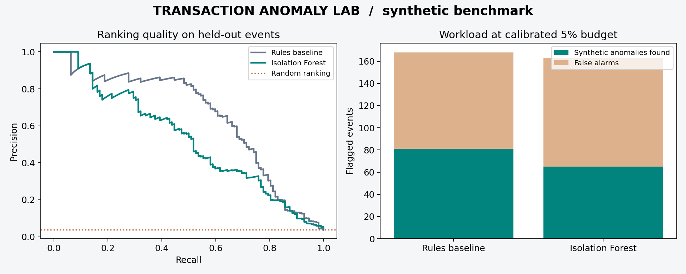
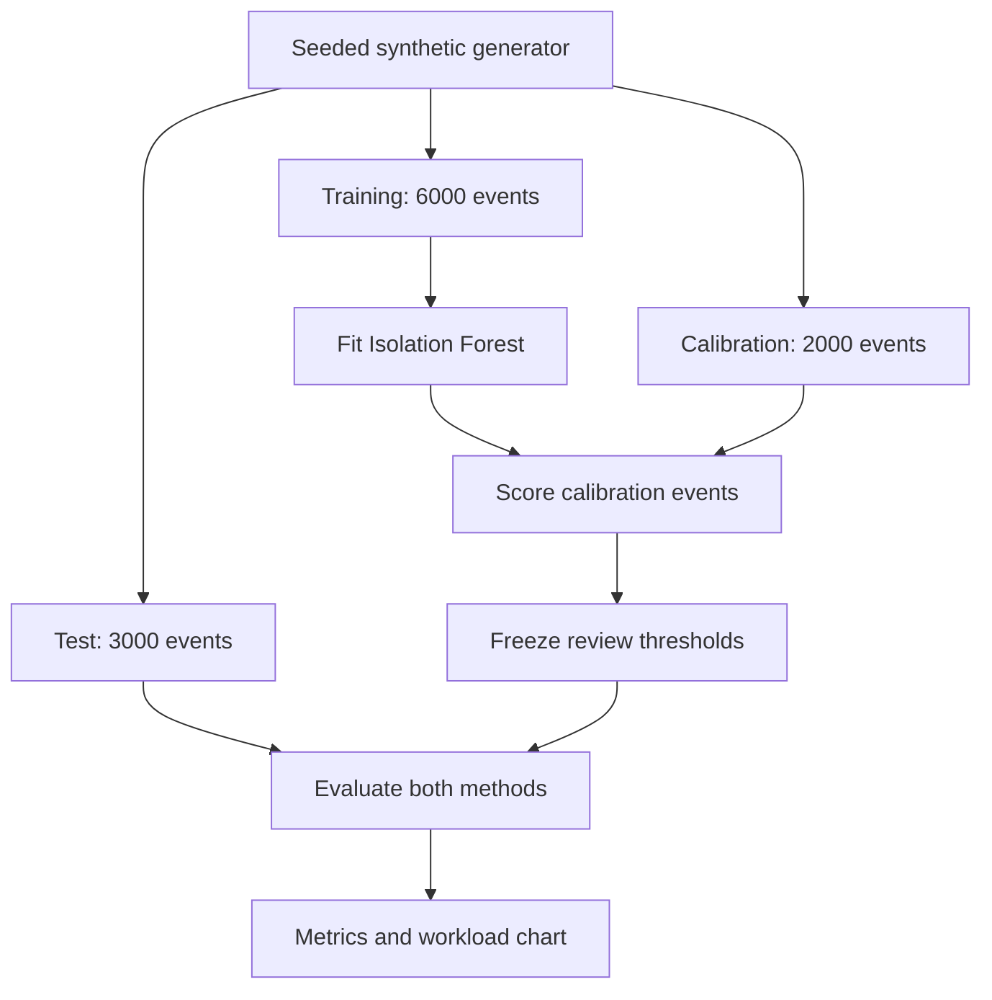

# Transaction Anomaly Lab

**A Python ML engineering portfolio: reproducible evaluation, a typed scoring API, SQL audit records, and container verification.**

[](https://github.com/rithmsAI/transaction-anomaly-lab/actions/workflows/ci.yml)

**[Try the live interactive case study](https://rithmsai.github.io/tripleten-portfolio/projects/transactions/)** · [Executed validation notebook](notebooks/01_validation.ipynb)

**Start here:** [Two-minute recruiter tour](docs/RECRUITER.md) · [Downloadable interactive explorer](demo/index.html) · [Scoring API and Docker](docs/SERVICE.md) · [Employer requirements → evidence](docs/REQUIREMENTS_MAP.md) · [Interview walkthrough](docs/WALKTHROUGH.md)

## Review this project in two minutes

**Question:** Which transactions deserve investigation when review capacity is limited?

**Engineering evidence:** Python model evaluation, a typed FastAPI service, authenticated requests, SQL audit records, retry handling, Docker, and automated checks.

**Key finding:** The rules baseline beat Isolation Forest in this synthetic experiment. The project makes that tradeoff visible instead of assuming a more complex model is better.

**Try it:** Download [demo/index.html](demo/index.html) using GitHub's **Download raw file** button, then open it in your browser. Change the calibration review budget to compare useful findings and false alarms. No Python installation is required. The explorer uses actual precomputed experiment results; it is not a live API or production fraud detector.

The project now includes 24 tests covering model behavior, strict API validation, authentication, concurrent retries, restart persistence, and audit-storage failure. GitHub Actions checks both the experiment and a running Docker container. The API is a local demo, not a hosted financial service.

What should a team investigate when it can review only about 5% of transactions? This project evaluates two ways to rank events, measures the false-alarm workload, and makes the limitations visible.

All transactions are fictional, generated locally. No customer records, employer materials, external APIs, credentials, or commercial product code are used.



## Result first

In the included seed-42 experiment, the rules baseline outperformed Isolation Forest. Keeping the simpler approach is a reasonable conclusion for this particular simulator. These are **synthetic benchmark results**, not real-world fraud-detection performance.

| Held-out metric | Rules baseline | Isolation Forest |
|---|---:|---:|
| Average precision | 0.649 | 0.523 |
| Precision at calibrated threshold | 48.2% | 39.9% |
| Recall at calibrated threshold | 72.3% | 58.0% |
| Anomalies found | 81 | 65 |
| False alarms | 87 | 98 |
| Anomalies missed | 31 | 47 |
| Actual test alert rate | 5.60% | 5.43% |

The test contains 3,000 events, including 112 synthetic anomalies. Both thresholds are independently calibrated to an approximate 5% review rate on a separate 2,000-event set. A fixed threshold does not guarantee the same rate on new data. Results are recorded in [metrics.json](reports/metrics.json).

## Run it

Python 3.12 is the tested runtime. From the extracted project folder:

```bash
python -m venv .venv
```

Activate on Windows PowerShell:

```powershell
.venv\Scripts\Activate.ps1
```

Or on macOS/Linux:

```bash
source .venv/bin/activate
```

Then:

```bash
python -m pip install -r requirements-api.txt
python -m unittest discover -s tests -v
python lab.py
```

Open `reports/benchmark.png` to see the comparison. The command also writes metrics and 30 sample transactions. No accounts, API keys, or paid services are required.

Try another review budget without overwriting the included results:

```bash
python lab.py --budget 0.02 --seed 43 --output reports/experiment-43
```

## Behavior-shift experiment

Run `python evaluate_shift.py` for five independently seeded experiments. The shifted scenario changes only legitimate transactions: amounts are multiplied by three and distances increased by 100 km. Thresholds remain frozen. Anomalous events are unchanged, so recall is unchanged by construction; false alarms and ranking quality can deteriorate.

| Mean across 5 seeds | Rules baseline | Isolation Forest |
|---|---:|---:|
| Original precision | 54.8% | 45.7% |
| Shifted precision | 21.2% | 17.7% |
| Original alert rate | 5.53% | 5.59% |
| Shifted alert rate | 14.25% | 14.55% |

[Full results](reports/shift_evaluation.json) include every run, sample standard deviations, and feature-distribution diagnostics. These are descriptive results from a designed synthetic stress test, not population confidence intervals. A KS-statistic threshold of 0.1 is a heuristic for review, not a calibrated production alarm. Drift detection alone does not prove model quality loss; this experiment can measure quality because it retains synthetic labels.

## Design



Rules are fixed in code before evaluation. The model fits only on training features, without labels; training includes a small anomaly population. Separate random streams supply calibration and test events. Calibration labels are never used. The generator's anomaly labels are used only for final evaluation.

The model sees log-transformed amount, distance, recent transaction count, and account age. Its score is a ranking signal, not a probability. Lower native Isolation Forest scores indicate greater abnormality, so the implementation negates them. See [scikit-learn's API documentation](https://scikit-learn.org/stable/modules/generated/sklearn.ensemble.IsolationForest.html).

## Why these choices?

- **Baseline first:** a model has to justify its extra complexity.
- **Separate calibration:** thresholds are selected without test labels or test scores.
- **Average precision:** measures ranking quality across thresholds for a rare positive class.
- **False-alarm counts:** show the operational cost behind a precision percentage.
- **Seeded data and pinned direct dependencies:** make results easier to reproduce.
- **Input validation:** rejects malformed shapes, nonfinite values, negative features, and fractional transaction counts.

See [engineering notes](docs/ENGINEERING.md) for assumptions and tradeoffs, and [walkthrough](docs/WALKTHROUGH.md) for a five-minute demonstration.

## Limits and next experiments

The generator is intentionally simple. Rules use domain assumptions that closely match its anomaly patterns, so this is not a neutral comparison across real financial behavior. Events are independent; there are no customer histories, time drift, delayed labels, or real investigator decisions. A single seed does not establish statistical reliability. Unusual does not mean fraudulent.

The extension adds five-seed evaluation and a legitimate travel/purchase shift. Before claiming generalization, expand these scenarios and use a properly licensed real dataset with temporal and entity-aware splits. Live systems would also need security, monitoring, privacy review, and human review processes. This repository is an educational experiment with a local API; it has no production deployment.

## Repository guide

| File | Purpose |
|---|---|
| `lab.py` | Generate, validate, train, calibrate, evaluate, and chart |
| `tests/` | 18 tests across modeling, API reliability, and shift diagnostics |
| `api.py` | Authenticated scoring, typed contracts, SQL audit and retry handling |
| `evaluate_shift.py` | Five-seed paired original/shifted evaluations |
| `Dockerfile` | Non-root service container |
| `reports/` | Actual generated results and fictional sample events |
| `.github/workflows/ci.yml` | Run tests, experiments, and container HTTP checks on pushes and pull requests |
| `docs/` | Engineering explanation, demo guide, and publishing steps |

## Development provenance

This initial implementation and documentation were prepared with AI assistance. Portfolio ownership should be demonstrated through review, explanation, and subsequent improvements; the repository does not claim unaided authorship or production deployment. Do not describe generated benchmarks as business impact.

No open-source license has been selected yet. Public visibility and permission to reuse code are separate decisions; select a license deliberately before inviting reuse.


## SIS310 validation extension (local working release)

See [new validation evidence and reproduction steps](docs/SIS310_EXTENSION.md) and `notebooks/01_validation.ipynb`. Run `python validation_audit.py` for additional metrics and paired uncertainty. See TEST_RESULTS.txt for the verified 24-test run, including the SQLite connection-closure fix.
