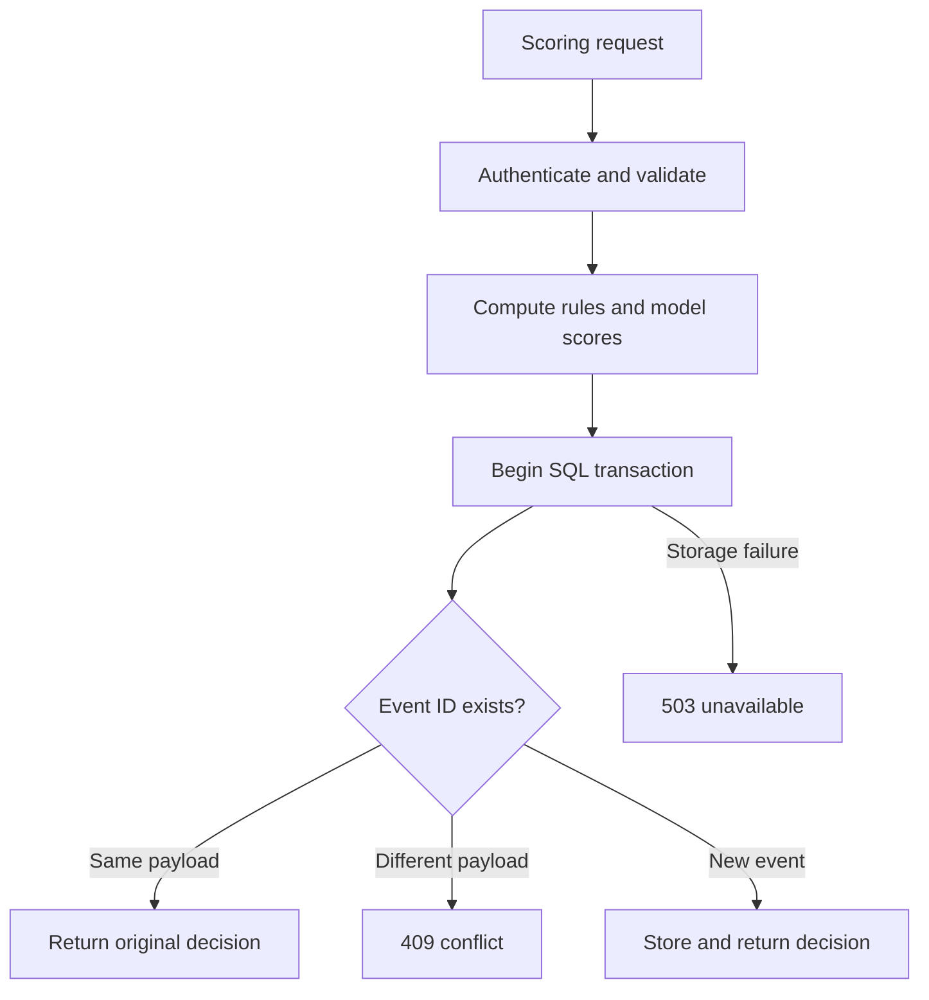

# Two-minute technical tour

**Transaction Anomaly Lab — Kaya Robinson**

A Python portfolio project connecting ML evaluation to an authenticated scoring service and SQL audit trail. Built with AI assistance; the code, reproducible experiments, tests, and limitations are available for inspection.

## Try the experiment without installing Python

Open [demo/index.html](../demo/index.html) on GitHub, choose **Download raw file**, and open the downloaded HTML in a browser. Or download the repository ZIP and open that file. No server, account, API key, or dependency installation is needed. GitHub's file viewer displays source rather than running HTML.

Change the calibration budget from 5% to 1% or 10%. Compare anomalies found, false alarms, recall, and actual test workload. This is a standalone explorer of precomputed synthetic results; it does not call the scoring API. Rebuild with `python scripts/build_demo.py` after installing the project dependencies.

## Where to look

| Capability | Inspectable evidence | Question to discuss |
|---|---|---|
| ML evaluation | `lab.py`, `reports/metrics.json` | Why keep separate training, calibration, and test sets? |
| Engineering judgment | README results and limitations | Why does the simpler rules baseline win here? |
| Backend development | `api.py`, `tests/test_api.py` | What happens when a client retries a request? |
| Data integrity | SQLite transaction and payload hash | Why reject a reused ID with changed features? |
| Failure handling | Authentication, validation, storage-failure tests | When should the service fail closed? |
| Reproducible delivery | Dockerfile and GitHub Actions | Which checks exercise a real HTTP container? |
| Behavior shift | `evaluate_shift.py` | How can legitimate behavior changes increase false alarms? |

## Request lifecycle

## 90-second recording outline

This is a suggested recording outline, not a completed video.

- **0–15 seconds:** Explain the question: which events deserve investigation when review capacity is limited?
- **15–40 seconds:** Open the explorer at 5%, then change the budget. Explain precision, recall, and false-alarm workload.
- **40–60 seconds:** Open `api.py`. Show authentication, strict input validation, and durable retry handling.
- **60–75 seconds:** Open the latest GitHub Actions run and a failure-case test. Only describe checks that actually passed.
- **75–90 seconds:** Explain the limitations: synthetic data, simulator bias, no production deployment. Describe the next experiment you would run.

## Scope and next steps

The project demonstrates implementation and evaluation skills; it does not claim production fraud prevention, customer impact, seniority, or unaided authorship. The API remains a local demo. No public API hosting, performance SLA, or real financial data is included. A next technical milestone would be measured API latency and a licensed dataset evaluated with temporal and entity-aware splits.
